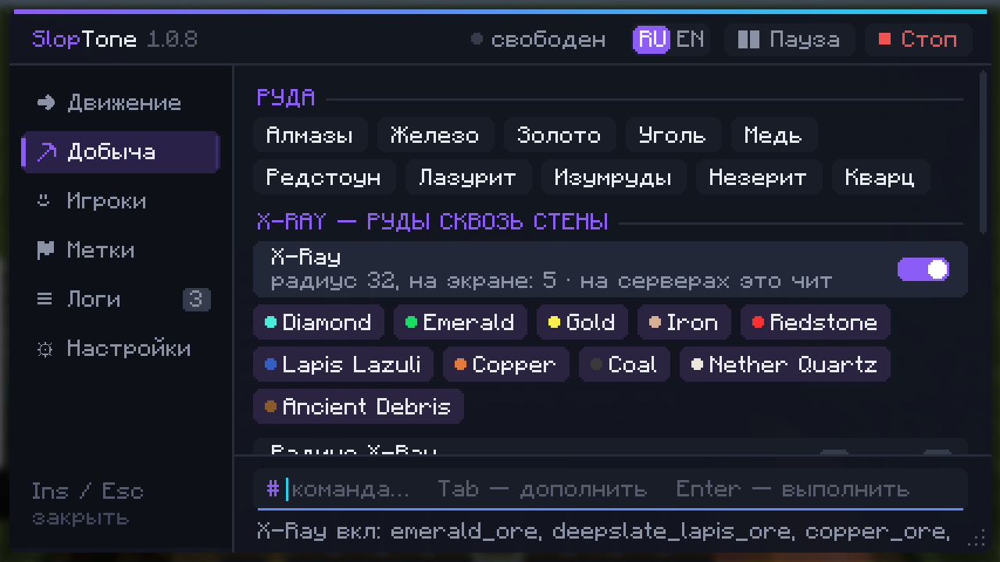
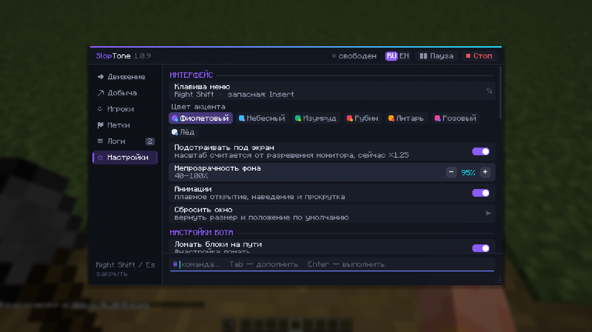
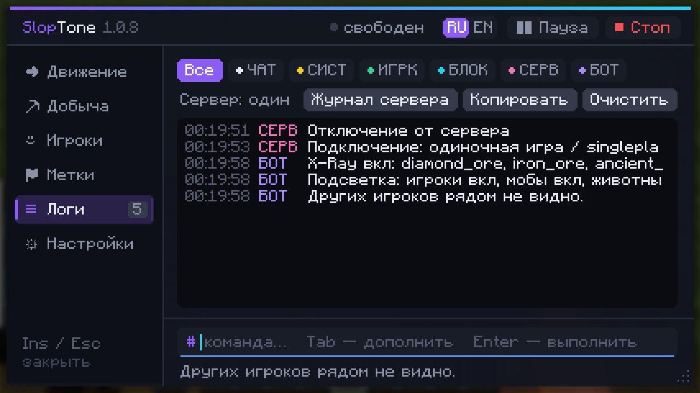
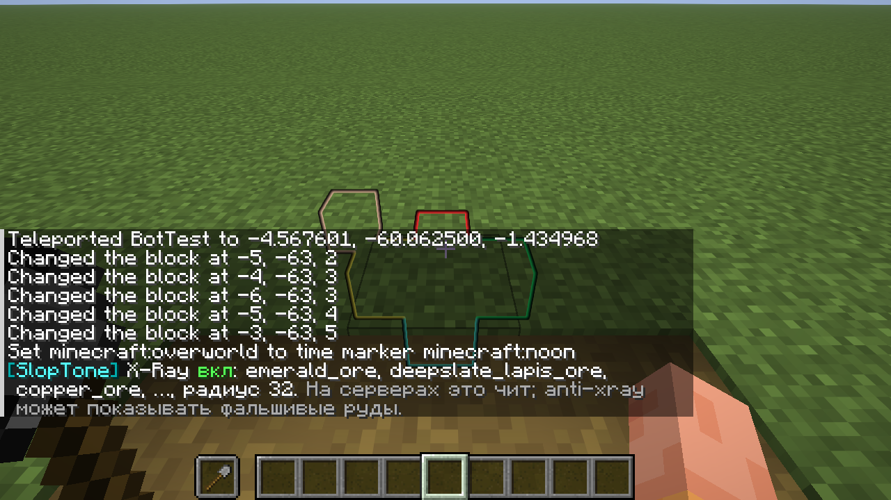

# SlopTone

A Baritone-style pathfinding bot for **Minecraft 26.3 (Forge 66)** by **manstruk**.
Commands are typed in chat with `#` — in Russian or English.

Бот-навигатор в стиле Baritone для **Minecraft 26.3 (Forge 66)** от **manstruk**.
Команды пишутся в чат через `#` — на русском или английском.

## Install / Установка

1. Install Forge 26.3 (66.0.2 or newer). / Установи Forge 26.3 (66.0.2 или новее).
2. Download `sloptone-1.0.10.jar` from [Releases](../../releases) and put it into `.minecraft/mods`.
   / Скачай `sloptone-1.0.10.jar` из [Releases](../../releases) и положи в `.minecraft/mods`.
3. Join a world and type `#help` (or `#помощь`). / Зайди в мир и напиши `#помощь`.

## Commands / Команды

| English | Русский | What it does / Что делает |
|---|---|---|
| `#goto x y z`, `#goto x z`, `#goto y`, `#goto <block>` | `#иди …` | walk to coordinates, a Y level or the nearest block / идти к координатам, высоте или блоку |
| `#mine <blocks…> [count]` | `#копай алмазы 10` | find and mine blocks, pick up drops / искать и добывать блоки |
| `#follow [name]` | `#следуй [ник]` | follow a player / следовать за игроком |
| `#farm [radius]` | `#ферма [радиус]` | harvest and replant crops / собирать урожай и сажать |
| `#tunnel [h w length]` | `#тоннель [в ш длина]` | dig a straight tunnel / копать прямой тоннель |
| `#explore`, `#surface`, `#thisway 200`, `#axis` | `#исследуй`, `#наверх`, `#туда 200`, `#ось` | explore, get to the surface, go forward, go to an axis |
| `#sethome` / `#home`, `#back` | `#дом` / `#домой`, `#назад` | home point, return to the last death point |
| `#wp save/goto/list/del <name>` | `#метка сохранить/иди/список/удалить <имя>` | waypoints / метки |
| `#stop`, `#pause`, `#resume`, `#status` | `#стоп`, `#пауза`, `#продолжить`, `#статус` | control the bot / управление |
| `#set [name] [value]` | `#настройка [имя] [значение]` | settings / настройки |
| `#who` | `#кто` | who placed the block under the crosshair, and when / кто и когда поставил блок под прицелом |
| `#whose [name] [radius]` | `#чьи [ник] [радиус]` | highlight blocks placed by players nearby / подсветить блоки игроков рядом |
| `#glow [players\|mobs\|animals\|all\|off]` | `#подсветка …` | outline players/mobs through walls / контур сквозь стены |
| `#xray [on\|off\|all\|ores…] [radius]` | `#xray алмазы золото` | ore X-Ray / подсветка руд сквозь стены |
| `#log [count]` | `#логи` | server command log (ops, SlopTone on the server) / журнал команд сервера |

## Menu / Меню — `Right Shift`, `Insert` or `#menu`



Open with **Right Shift** (default), **Insert** (second key) or the `#menu` / `#меню` chat command.
Compact menu with smooth animations: drag it by the header, resize from the bottom-right corner,
switch **RU | EN** in the header. It scales itself to your screen resolution.
Tabs: Movement, Mining (with X-Ray), Players, Waypoints, **Logs**, Settings.
The command line at the bottom autocompletes commands, blocks, waypoints, players and settings
(Tab / Enter / ↑↓ history).

Открывается **правым Shift**, **Insert** или командой `#меню`. Тащи за шапку, меняй размер за правый нижний угол,
RU | EN в шапке; размер сам подстраивается под экран.



**Settings → Interface / Настройки → Интерфейс:** menu key (press to rebind), 7 accent colours, fit-to-screen or
manual scale ×0.5–×3, background opacity, animations on/off, reset window.

## Logs / Логи



A console-style log of everything the client receives: chat, system messages, players joining/leaving and
changing game mode, blocks other players place/break, admin command feedback (sent to ops), bot messages.
Filters, copy to clipboard, and `config/sloptone/logs/YYYY-MM-DD.log`.
With SlopTone on the server, ops can also read the server's command log (`/sloptone log`).

## X-Ray



Ores get a coloured outline visible through walls (client-only block displays, nothing is sent to the server).
**Using it on servers is cheating and can get you banned; anti-xray servers will show fake ores.**

Russian block names work too: `алмазы`, `железо`, `золото`, `уголь`, `дерево`, `незерит`…
Tree species too / породы деревьев: `береза`, `дуб`, `ель`, `акация`, `темный дуб`, `бледный дуб`, `вишня`,
`мангр`, `тополь`, `тропическое` — also as `березовое бревно`, `еловая древесина` and so on.

## Player builds / Постройки игроков

The bot does not mine blocks that players placed, and the pathfinder walks around them instead of
breaking through (`#set ignorePlaced false` / `#настройка постройки нет` turns this off).

Бот не копает блоки, поставленные игроками, и обходит постройки, а не ломает их.

- Singleplayer / LAN host: every block placed by any player is recorded exactly.
- Remote servers: your own placements are recorded; trees are told apart from log houses by their
  natural leaves, which works everywhere.
- `#who` / `#кто` shows the recorded player name and time. Minecraft itself does not store who placed
  a block, so only blocks placed while SlopTone 1.0.5+ was running are known.

## Who placed it / Кто поставил

| Command | What it does / Что делает |
|---|---|
| `#кто` / `#who` | who placed the block under the crosshair; asks the server if the client does not know |
| `#чьи [ник] [радиус]` / `#whose` | highlights player-placed blocks nearby with particles (one colour per player) and counts them |

Where the data comes from / Откуда данные:

1. **Server with SlopTone installed** (exact): put the same `sloptone-x.y.z.jar` into the server's `mods` folder.
   The server records every block of every player and answers `/sloptone who x y z` and
   `/sloptone near [radius] [player]` — usable by any player, even without the mod.
   Players without the mod can still join.
2. **Any server, client-side**: the client watches players within 96 blocks; when a player swings and a block appears
   where they were looking, it is recorded as theirs.
3. **Singleplayer / LAN host**: every block of every player is recorded exactly.

## Features / Возможности

- A* pathfinding on a background thread: walking, sprinting, diagonals, jumping up, falling,
  swimming, ladders, breaking blocks, bridging and pillaring.
- Mining goes to the best Y level for the ore and branch-mines when nothing is visible.
- Auto tool, auto eat, does not break nearly broken tools, avoids digging into lava.
- "Legit" mining mode (only exposed ores), death waypoint, path shown with particles.

## Build / Сборка

No Gradle needed: `build.ps1` compiles against the Forge 26.3 install of the local launcher
(`%APPDATA%\.minecraft`) using its bundled Java 25.

```powershell
./build.ps1
```

The jar is written to `build/sloptone-1.0.10.jar`.

## License / Лицензия

SlopTone License 1.0 — see [LICENSE.txt](LICENSE.txt) (Russian translation: [LICENSE_RU.txt](LICENSE_RU.txt)).
Free to play with and to include unmodified in free modpacks; no re-uploads, paid use or forks
without the author's permission.

Many servers do not allow bots like this — check the rules first.
